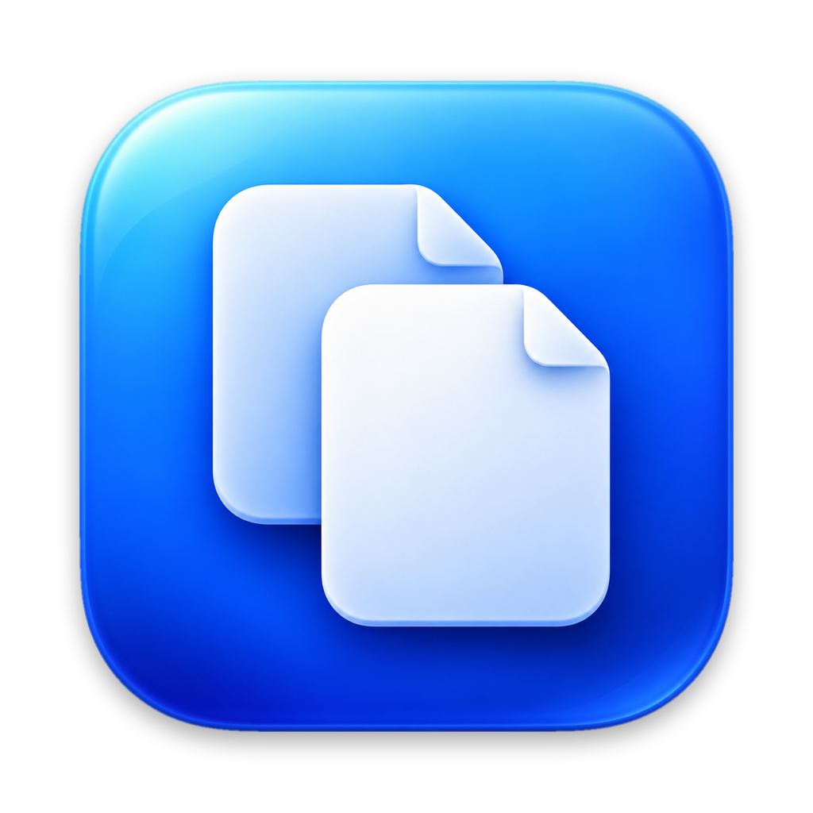
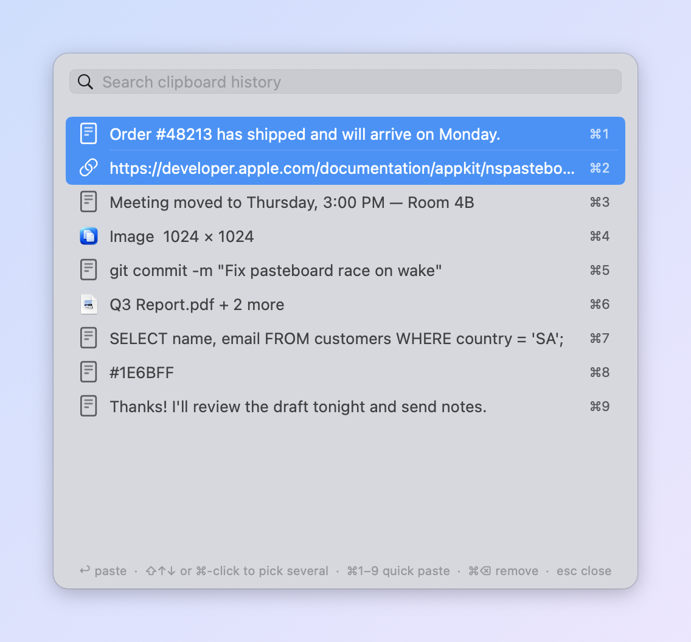

<div align="center">



# MultiCopy

**Copy many things. Paste any of them, or several at once.**

A small, private clipboard history for the macOS menu bar.

[](../../releases/latest/download/MultiCopy.dmg)


[](LICENSE)

<br>

<picture>
  <source media="(prefers-color-scheme: dark)" srcset="docs/screenshot-dark.png">
  
</picture>

</div>

## Features

- **Clipboard history**: everything you copy (text, links, rich text, images, files) is kept
  in a searchable list.
- **Paste several at once**: select a few items and paste them together, in the order you
  copied them.
- **Keyboard first**: press ⇧⌘V, type to search, press ↩ to paste. Or press ⌘1–⌘9 for an
  instant paste.
- **Private by design**: history is kept in memory only, there is no network access, and
  copies from password managers are skipped.
- **Light**: about 2 MB, no dependencies, and close to 0% CPU when idle.
- **Runs on macOS 12 Monterey and later**, natively on Apple silicon and Intel.

## Install

1. [**Download MultiCopy.dmg**](../../releases/latest/download/MultiCopy.dmg) from the
   [latest release](../../releases/latest).
2. Open it and drag **MultiCopy** into **Applications**.
3. Open MultiCopy from Applications. A clipboard icon appears in the menu bar.

<details>
<summary><b>macOS says it can't verify MultiCopy?</b></summary>

<br>

MultiCopy isn't notarized by Apple yet, so macOS asks you to confirm the first time you open it.

- **macOS 15 Sequoia and later:** open MultiCopy and click **Done** on the warning. Then go to
  **System Settings › Privacy & Security**, scroll down to the message about MultiCopy, and click
  **Open Anyway**.
- **macOS 12–14:** Control-click MultiCopy in Applications, choose **Open**, then click **Open**.

You only need to do this once. To check that your download is genuine, compare its checksum
with the `MultiCopy.dmg.sha256` file on the release page:

```bash
shasum -a 256 ~/Downloads/MultiCopy.dmg
```
</details>

### Permissions

| Permission | What it's for | Required? |
|---|---|---|
| **Accessibility** | Pressing ⌘V for you after you pick an item | No. Without it, the item is put on the clipboard and you press ⌘V yourself |
| **Paste from Other Apps** (macOS 15.4+) | Reading what you copy | Yes, if macOS asks. Choose **Always Allow** |

## Usage

Press **⇧⌘V** anywhere, or click the menu bar icon.

| Key | Action |
|---|---|
| *type* | Search the history |
| ↑ ↓ | Move through the list |
| **↩** | Paste into the app you were using |
| **⇧↑ ⇧↓** or **⌘-click** | Select several items |
| ⌘1 … ⌘9 | Paste that item right away |
| ⌘⌫ | Remove the selected items from the history |
| esc | Clear the search, then close |

**Pasting several items:** they paste in the order you copied them.

- Text is joined into one paste, one item per line.
- Files are pasted together, for example into a Finder folder.
- Mixed content, such as text and images, is pasted one item after another.

**Settings** (in the menu bar menu):

- **Paste Automatically**
- **Clear History on Lock & Sleep**
- **Launch at Login**
- **History Size**: 25 to 200 items
- **Shortcut**: ⇧⌘V, ⌥⌘V, ⌃⌘V or ⌃⌥⌘V

The menu bar menu also has **Pause Capturing** and **Clear History**.

> [!TIP]
> Chrome, Slack and Google Docs use ⇧⌘V for *Paste and Match Style*. If you rely on that, pick
> another shortcut under **Settings › Shortcut**.

## Privacy & security

- **Memory only.** Your clipboard history is never written to disk. It's gone when you quit,
  log out or restart. The only file MultiCopy writes is its settings
  (`~/Library/Preferences/com.mohamedaref.multicopy.plist`).
- **No network access.** The app contains no networking code and opens no connections.
- **Password managers are respected.** MultiCopy doesn't record anything an app marks as
  concealed or transient ([nspasteboard.org](http://nspasteboard.org) markers, used by
  1Password, Bitwarden, KeePassXC, Apple Passwords and others). It also ignores everything copied
  from Keychain Access, Passwords, 1Password, Bitwarden, KeePassXC, LastPass and Enpass.
- **Bounded memory.** Only standard formats are kept. Each entry is capped at 16 MB and the whole
  history at 64 MB; the oldest entries are dropped first.
- **Your shortcut stays private.** The global shortcut uses the system hot-key API, which sees
  only its own key combination. There is no keylogging and no event tap.
- **Hardened runtime**, code-signed, no entitlements, no third-party code.
- **Not sandboxed.** The App Sandbox blocks apps from sending keystrokes to other apps, so
  auto-paste couldn't work inside it.

To ignore another app, add its bundle ID, then restart MultiCopy:

```bash
defaults write com.mohamedaref.multicopy ignoredBundleIDs -array com.example.App
```

## Build from source

You need Xcode or the Command Line Tools (`xcode-select --install`).

```bash
git clone https://github.com/iNATS/MultiCopy.git && cd MultiCopy
./build.sh            # → build/MultiCopy.app  (universal, macOS 12+)
./build.sh install    # also copies it to /Applications and launches it
./release.sh          # → build/release/MultiCopy.dmg + MultiCopy.dmg.sha256
```

`release.sh` creates the drag-to-Applications disk image with
[dmgbuild](https://github.com/dmgbuild/dmgbuild). dmgbuild is installed into
`build/.dmgbuild-venv`, pinned by hash, and is used only at build time.

<details>
<summary><b>Publishing a release</b></summary>

<br>

1. Bump `VERSION` in `build.sh`, then run `./release.sh`.
2. On GitHub, go to **Releases › Draft a new release** and create a tag such as `v1.0.0`.
3. Attach `build/release/MultiCopy.dmg` and `build/release/MultiCopy.dmg.sha256`. Keep the file
   name `MultiCopy.dmg`: the download button links to it.

To ship without the Gatekeeper warning, sign with a **Developer ID Application** certificate and
notarize:

```bash
xcrun notarytool store-credentials multicopy-notary   # one time
SIGN_IDENTITY="Developer ID Application: Your Name (TEAMID)" \
NOTARY_PROFILE=multicopy-notary ./release.sh
```
</details>

### Project layout

```
Sources/
  main.swift              app entry point (menu bar only, single instance)
  AppDelegate.swift       menu bar menu, settings, wiring
  ClipboardMonitor.swift  detects new copies, privacy filters, size limits
  ClipItem.swift          one history entry: title, icon, search
  HistoryStore.swift      in-memory history: duplicates, limits, memory budget
  HistoryPanel.swift      the ⇧⌘V picker window
  Paster.swift            writes the clipboard and presses ⌘V (works with any keyboard layout)
  HotKey.swift            global shortcut
  Settings.swift          preferences, shortcut presets, launch at login
Resources/
  AppIcon.png             1024 × 1024 icon master (replace it to change the icon)
  Info.plist
  dmg/                    disk image background, layout and pinned build tool
docs/                     README screenshots
build.sh                  builds and signs the app
release.sh                builds the DMG for a GitHub release
```

## Uninstall

1. Quit MultiCopy from its menu.
2. Delete `/Applications/MultiCopy.app`.
3. Optionally, run `defaults delete com.mohamedaref.multicopy`.
4. If you turned on Launch at Login on macOS 12, also delete
   `~/Library/LaunchAgents/com.mohamedaref.multicopy.plist`.

## License

MIT. See [LICENSE](LICENSE).
